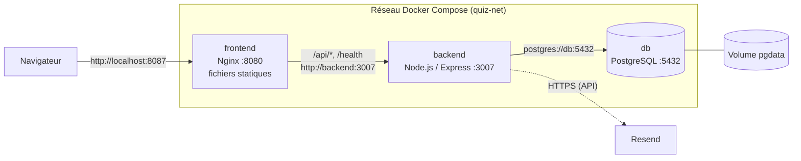
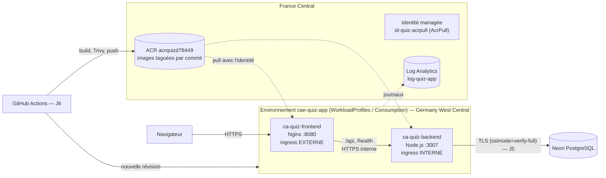

# Architecture et analyse technique — Quiz App

Analyse réalisée à partir du code fourni (`main.js`, `backend/server.js`, `nginx/nginx.conf`, `database/init.sql`, `vite.config.js`).

## 1. Composants et dépendances

| Composant | Rôle | Dépend de |
|---|---|---|
| **Frontend** (Vite) | Pages `index.html` (quiz) et `gestion-quiz.html` (admin). `npm run build` produit des fichiers **statiques** dans `dist/`. | Rien à l'exécution (fichiers statiques) |
| **Nginx** | Sert les fichiers statiques et redirige `/api/` et `/health` vers le backend (reverse proxy). | Backend |
| **Backend** (Node.js / Express) | API REST : utilisateurs, résultats, administration (JWT), envoi d'email. | PostgreSQL, Resend (externe) |
| **PostgreSQL** | Stocke `users`, `quiz_results`, `answers` (schéma : `database/init.sql`). | Volume de stockage |
| **Resend** | Service externe d'envoi d'emails. | Clé API |

Le frontend appelle le backend avec des **URL relatives** (`/api/users`, `/api/results`, `/api/admin/...`) : le navigateur parle uniquement à Nginx, qui transmet au backend. Le backend n'a donc **pas besoin d'être exposé** à l'extérieur.

## 2. Ports

| Composant | Port en développement | Port dans le conteneur | Exposé sur l'hôte (Compose) |
|---|---|---|---|
| Frontend / Nginx | 5173 (Vite dev) | **8080** (Nginx non-root) | **8087** → `http://localhost:8087` |
| Backend | 3007 | **3007** (`PORT`) | Non (réseau interne uniquement) |
| PostgreSQL | 5432 | **5432** | Non (réseau interne uniquement) |

Nginx écoute sur 8080 et non sur 80 : un port inférieur à 1024 exige les droits root, et l'image choisie tourne sans root.

## 3. Variables de configuration

| Variable | Utilisée par | Nature | Remarque |
|---|---|---|---|
| `POSTGRES_USER`, `POSTGRES_DB` | PostgreSQL local | Paramètre | |
| `POSTGRES_PASSWORD` | PostgreSQL local | **Secret** | |
| `DATABASE_URL` | Backend | **Secret** (contient le mot de passe) | Local : construite par Compose vers `db:5432`. Cloud : chaîne Neon stockée en secret Azure. |
| `RESEND_API_KEY` | Backend | **Secret** | **Obligatoire au démarrage** : sans elle, `new Resend()` lève « Missing API key » et le backend s'arrête. Une valeur factice suffit en local (l'envoi échoue, mais l'erreur est capturée et le résultat est enregistré). |
| `FROM_EMAIL` | Backend | Paramètre | Facultatif (valeur par défaut dans le code) |
| `ADMIN_USERNAME` | Backend | Paramètre | Défaut `admin` |
| `ADMIN_PASSWORD`, `JWT_SECRET` | Backend | **Secret** | Valeurs par défaut faibles dans le code : à toujours définir |
| `PORT` | Backend | Paramètre | Défaut 3007 |
| `BACKEND_URL` | Nginx (frontend) | Paramètre | Ajoutée par nous : adresse du backend (`http://backend:3007` en local, adresse interne Azure au J4) |

## 4. Routes utiles pour les tests

| Route | Usage | Dépend de PostgreSQL ? |
|---|---|---|
| `GET /health` | Santé du backend → `{"status":"ok"}` | **Non** (aucune requête SQL) |
| `POST /api/users` | Inscription | Oui |
| `POST /api/results` | Enregistrement d'un résultat (+ email) | Oui |
| `POST /api/admin/login` puis `GET /api/admin/results` | Vérifier les résultats enregistrés | Oui |

Le pool `pg` ne se connecte qu'à la **première requête SQL** : le backend peut démarrer et répondre à `/health` même sans base (utile pour le J4).

## 5. Questionnaires et données

- Les questions sont dans les fichiers `questions_*.js` à la racine. `main.js` les charge avec `import.meta.glob("./questions_*.js")` : elles sont **intégrées au moment du build**. Modifier une question impose donc de **reconstruire l'image frontend**, ce qui est la base de la démonstration CI/CD.
- Les résultats sont enregistrés dans PostgreSQL (`users` → `quiz_results` → `answers`).

## 6. Persistance

- PostgreSQL range ses données dans `/var/lib/postgresql/data`. On y monte un **volume nommé** `pgdata` : les données survivent à la suppression et à la recréation des conteneurs (`docker compose down` puis `up`). Seul `docker compose down -v` efface le volume.
- `database/init.sql` est monté dans `/docker-entrypoint-initdb.d/`. L'image PostgreSQL l'exécute **uniquement quand le volume est vide** (premier démarrage). C'est pourquoi les tables ne sont pas recréées et les données ne sont pas perdues aux démarrages suivants.
- Le script n'a pas de `IF NOT EXISTS` : le relancer sur une base déjà initialisée (Neon au J5) renvoie « relation already exists ».

## 7. Schéma — architecture locale (Docker Compose)

## 8. Schéma — architecture cloud (déployée au J4)

| Point | Local (Compose) | Cloud (Azure) |
|---|---|---|
| Entrée | `http://localhost:8087` | URL HTTPS du frontend (ingress externe) |
| Frontend vers backend | `http://backend:3007` (nom du service) | `https://ca-quiz-backend.internal.<domaine>` (ingress interne) |
| Base de données | Conteneur `db` + volume `pgdata` | Neon (externe), chaîne en secret `database-url` |
| Secrets | `.env` (non versionné) | Secrets des Container Apps, alimentés par `.env.azure` (non versionné) |
| Images | Construites localement | ACR, tag = SHA du commit |

Pourquoi deux régions : France Central a refusé la création de l'environnement Container Apps faute de **capacité** (voir `preuves/J4`). L'environnement est donc en Germany West Central, région autorisée par la stratégie de l'abonnement, tandis que l'ACR est resté en France Central.
