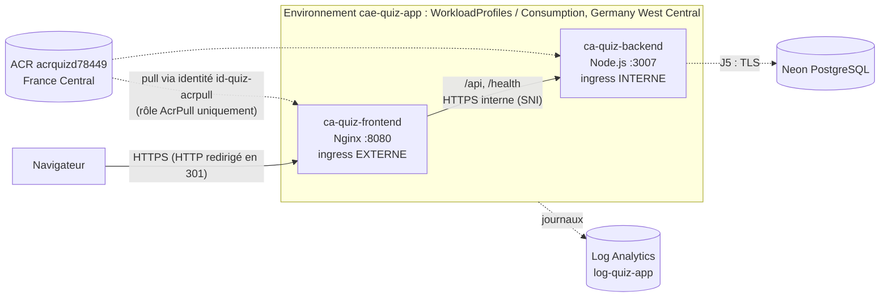

# J4 — Frontend et backend dans Azure Container Apps

**Date :** 17/11/2026
**Script :** `./scripts/deploy.sh` (réutilisable), nettoyage avec `./scripts/destroy.sh`
**Images déployées :** tag `1574bbd`, c'est-à-dire le commit Git déployé.

Les identifiants d'abonnement ont été retirés de ce document.

## 1. Architecture déployée



| Ressource | Nom | Région |
|---|---|---|
| Registre | `acrquizd78449` (Basic, compte admin désactivé) | France Central |
| Identité managée | `id-quiz-acrpull` (rôle `AcrPull` sur l'ACR seulement) | France Central |
| Log Analytics | `log-quiz-app` | France Central |
| Environnement | `cae-quiz-app`, mode **WorkloadProfiles**, profil **Consumption** | **Germany West Central** |
| Container App backend | `ca-quiz-backend` | Germany West Central |
| Container App frontend | `ca-quiz-frontend` | Germany West Central |

**URL publique :** https://ca-quiz-frontend.happysand-8f33d265.germanywestcentral.azurecontainerapps.io

## 2. Configuration des applications

| Paramètre | Backend | Frontend |
|---|---|---|
| Ingress | **interne** (joignable seulement depuis l'environnement) | **externe** (public) |
| Port cible | 3007 | 8080 (Nginx non-root) |
| HTTP en clair autorisé | non | non (redirection 301 vers HTTPS) |
| Réplicas min / max | 0 / 1 | 0 / 1 |
| CPU / mémoire | 0,25 vCPU / 0,5 Gio | 0,25 vCPU / 0,5 Gio |
| Accès au registre | identité managée `id-quiz-acrpull` | identité managée `id-quiz-acrpull` |
| Secrets (noms seulement) | `resend-api-key`, `admin-password`, `jwt-secret` | aucun |
| Variables d'environnement | `PORT`, `ADMIN_USERNAME`, `FROM_EMAIL`, et `RESEND_API_KEY`, `ADMIN_PASSWORD`, `JWT_SECRET` en `secretref:` | `BACKEND_URL` |

**Communication interservices :** Nginx transmet `/api/` et `/health` à `BACKEND_URL`, l'adresse **interne** HTTPS du backend (`https://ca-quiz-backend.internal.<domaine-environnement>`). Les deux réglages nécessaires sur Azure :
- `proxy_set_header Host $proxy_host` : l'ingress Azure choisit l'application destinataire d'après l'en-tête `Host` ;
- `proxy_ssl_server_name on` : envoie le nom d'hôte dans la négociation TLS (SNI).

En local, la même image utilise `BACKEND_URL=http://backend:3007`. Seule la configuration change.

**Secrets :** les valeurs viennent du fichier local `.env.azure` (non versionné, voir `.env.azure.example`). Elles sont stockées dans les **secrets** de la Container App, et les variables d'environnement n'en contiennent qu'une **référence** (`secretref:`). Rien n'est écrit dans l'image, les scripts ou le dépôt.

**Moindre privilège :** les Container Apps tirent les images avec une identité managée qui n'a que le rôle `AcrPull` sur ce seul registre. Il n'y a ni mot de passe ni compte administrateur ACR.

## 3. État des révisions

```text
Revision                         Active  Etat               Sante    Replicas  Trafic
ca-quiz-backend--v261117154349   True    RunningAtMaxScale  Healthy  1         100
ca-quiz-frontend--v261117154349  True    RunningAtMaxScale  Healthy  1         100
```

Le suffixe `v261117154349` est l'horodatage du déploiement (17/11/26 à 15:43:49). Chaque exécution de `deploy.sh` crée une nouvelle révision identifiable. Avec `minReplicas = 0`, les révisions repassent à 0 réplica quand l'application ne reçoit pas de trafic.

## 4. Tests

| Test | Résultat |
|---|---|
| `GET /health` via le frontend | **HTTP 200** `{"status":"ok"}`, en-tête `x-powered-by: Express` : la réponse vient du backend |
| `GET /` et `GET /gestion-quiz` | HTTP 200 |
| `POST /api/admin/login` (mauvais identifiants, aucune requête SQL) | HTTP 401 `{"error":"Invalid credentials"}` : Nginx transmet bien `/api` au backend |
| Backend appelé **directement depuis internet** (adresse `.internal.`) | **HTTP 404** : le backend n'est pas exposé |
| `http://` sur le frontend | HTTP 301 vers `https://` |
| `POST /api/users` (inscription, requête SQL) | HTTP 500 : base absente au J4 (voir le diagnostic) |

```bash
curl -i https://ca-quiz-frontend.happysand-8f33d265.germanywestcentral.azurecontainerapps.io/health
# HTTP/2 200
# content-type: application/json; charset=utf-8
# x-powered-by: Express
# {"status":"ok"}
```

## 5. Diagnostic : le backend sans base de données

Journaux du backend (`az containerapp logs show -n ca-quiz-backend -g rg-quiz-app --type console`) :

```text
2026-11-17T14:44:37Z stdout  Server running on port 3007
2026-11-17T14:46:16Z stderr  Error creating user: Error: connect ECONNREFUSED 127.0.0.1:5432
                             at /app/node_modules/pg-pool/index.js:45:11
                             at async file:///app/server.js:284:20
```

**Explications :**

1. **Le backend démarre sans PostgreSQL.** Le pool `pg` ne se connecte qu'à la première requête SQL, et `/health` n'en fait aucune. C'est pour ça qu'il répond 200.
2. **Les routes SQL échouent**, ce qui est attendu au J4. `DATABASE_URL` n'est pas définie, donc `pg` utilise ses valeurs par défaut (`127.0.0.1:5432`) : une base locale qui n'existe pas dans le conteneur, d'où `ECONNREFUSED`.
3. **Une dépendance bloque vraiment le démarrage : `RESEND_API_KEY`.** Sans elle, `new Resend()` lève « Missing API key » et le processus s'arrête. Le secret `resend-api-key` est donc obligatoire, même avec une valeur factice.
4. **Correction au J5 :** ajouter la chaîne Neon dans `.env.azure` (`DATABASE_URL=...?sslmode=verify-full`), puis relancer `deploy.sh`. Le script crée le secret `database-url` et une nouvelle révision.

## 6. Incidents rencontrés et résolutions

| # | Symptôme | Cause | Résolution |
|---|---|---|---|
| 1 | `zsh: permission denied: ./scripts/deploy.sh` | Script créé sans droit d'exécution (mode Git `100644`) | `chmod +x` puis commit (mode `100755`) |
| 2 | `ExpressRevisionSuffixNotSupported` | `az containerapp env create` crée désormais par défaut un environnement **Express** : pas de suffixe de révision, pas de découverte de services interne, pas de domaine personnalisé | Environnement créé via l'API Azure (`az resource create`) avec `environmentMode: WorkloadProfiles` ; le script vérifie le mode obtenu |
| 3 | `MaxNumberOfEnvironmentsInSubExceeded` en France Central, alors que le quota indiquait 0/1 | **Capacité** régionale insuffisante pour cet abonnement (à ne pas confondre avec un quota, voir la doc Microsoft *Troubleshoot environment capacity errors*) | Le script essaie les régions autorisées dans l'ordre (`ACA_LOCATIONS`). Germany West Central a été acceptée. L'ACR reste en France Central |

## 7. Commandes de vérification

```bash
az containerapp list -g rg-quiz-app --query "[].{nom:name, etat:properties.provisioningState, fqdn:properties.configuration.ingress.fqdn}" -o table
az containerapp revision list -n ca-quiz-backend -g rg-quiz-app -o table
az containerapp logs show -n ca-quiz-backend -g rg-quiz-app --type console --tail 30
curl -i https://<fqdn-frontend>/health
```
