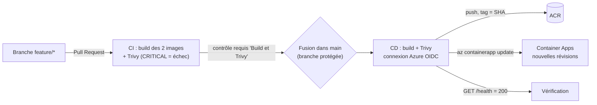

# J6 — CI/CD avec GitHub Actions

**Date :** 17/11/2026
**Dépôt (fork du groupe) :** https://github.com/faresfettah/eval-quiz-app
**Workflows :**

| Fichier | Rôle |
|---|---|
| `.github/workflows/ci.yml` | CI, déclenchée sur chaque Pull Request vers `main` |
| `.github/workflows/cd.yml` | CD, déclenchée après fusion dans `main` |

**Identité Azure :** `scripts/setup-github-oidc.sh`

Les identifiants Azure (client, tenant, abonnement) ont été retirés de ce document.

## 1. Fonctionnement

| | CI (`ci.yml`) | CD (`cd.yml`) |
|---|---|---|
| Déclencheur | `pull_request` vers `main` | `push` sur `main` (donc après une fusion). Ignore `preuves/`, `docs/`, `architecture/` et `*.md` |
| Étapes | build backend et frontend, rapport Trivy HIGH/CRITICAL archivé, **contrôle Trivy CRITICAL bloquant** | build, Trivy CRITICAL bloquant, connexion Azure **OIDC**, push dans l'ACR, `az containerapp update`, vérification des révisions et de `/health` |
| Secrets | **aucun** (une PR, même venant d'un fork, n'accède ni à Azure ni à l'ACR) | 3 identifiants pour OIDC, **aucun mot de passe** |
| Tag des images | `ci-<sha>`, jamais publié | **SHA court du commit** (ex. `9a8136e`) |
| Trivy | `aquasec/trivy:0.76.1` figé, `--exit-code 1` sur CRITICAL, sans `continue-on-error` | idem, avant toute publication |

**Chaîne d'approvisionnement :** chaque action GitHub est figée par l'**empreinte de son commit** (une étiquette comme `v7` peut être déplacée), avec des versions publiées depuis au moins 2 semaines. Les workflows ont été validés avec `actionlint` 1.7.12, shellcheck inclus : 0 erreur.

## 2. Authentification à Azure : OIDC et moindre privilège

- Une identité managée dédiée, `id-quiz-github`, est **fédérée** avec GitHub. Azure n'accepte que les jetons émis pour la **branche `main`** de ce dépôt. Une PR ou une autre branche ne peut pas se connecter.
- **Aucun mot de passe ni clé** n'est stocké dans GitHub. Les secrets `AZURE_CLIENT_ID`, `AZURE_TENANT_ID` et `AZURE_SUBSCRIPTION_ID` ne sont que des identifiants.
- Les droits sont limités aux besoins du déploiement :

| Rôle | Portée | Pourquoi |
|---|---|---|
| `AcrPush` + `Reader` | ACR `acrquizd78449` seulement | publier les images |
| `Container Apps Contributor` | groupe `rg-quiz-app` | créer de nouvelles révisions |
| `Managed Identity Operator` | identité `id-quiz-acrpull` seulement | conserver l'identité qui tire les images |

- La CD **ne connaît pas la chaîne PostgreSQL** : elle ne change que l'image, et les secrets restent dans les Container Apps.

## 3. Protection de la branche `main`

Règle classique sur `main` :
- *Require a pull request before merging* ;
- *Require status checks to pass* : contrôle **`Build et Trivy`** ;
- *Do not allow bypassing the above settings* : la règle s'applique aussi à l'administrateur ;
- *force push* et *suppression* interdits.

Vérification via l'API publique : `protected: true`, `contexts: ['Build et Trivy']`, `enforcement_level: everyone`.

**Approbation :** le dépôt n'a qu'un seul contributeur, et GitHub interdit d'approuver sa propre PR. L'option *Require approvals* n'est donc pas activée. Dans un groupe, un autre membre approuverait la PR avant la fusion.

## 4. Contrôle échoué, puis réussi (scénario contrôlé)

**PR #8 — `test/j6-trivy-bloquant` :** le correctif du J2 (`apk upgrade`) est retiré **volontairement**, ce qui fait revenir la vulnérabilité CRITICAL `CVE-2026-111497` (brotli-libs) dans l'image frontend. La CI ne publie aucune image : rien de vulnérable n'est poussé dans l'ACR.

| Exécution | Résultat |
|---|---|
| [CI 44193013738](https://github.com/faresfettah/eval-quiz-app/actions/runs/44193013738) (commit `84f4f94`) | ❌ échec à l'étape « Contrôle Trivy bloquant (CRITICAL) » : *Vulnérabilité CRITICAL dans quiz-frontend*, code de sortie 1 |
| [CI 44193325722](https://github.com/faresfettah/eval-quiz-app/actions/runs/44193325722) (commit `a4e3223`, relance après activation de la protection) | ❌ même échec |
| PR #8 | GitHub affiche **« Merging is blocked »**. La PR a été **fermée sans fusion** |

Capture : `01-ci-trivy-bloque-pr8.png`. Toutes les étapes sont vertes, sauf le contrôle Trivy CRITICAL.

Par contraste, les PR #6, #7 et #9 ont une CI **réussie**, donc fusionnable.

## 5. Démonstration complète : modification d'une question

| Étape | Preuve |
|---|---|
| Modification d'une question existante (`questions_docker.js`, question 1) | commit `476660b` sur `feature/j6-demo-question` |
| Pull Request vers `main` du fork | [PR #9](https://github.com/faresfettah/eval-quiz-app/pull/9) |
| CI : build + Trivy | [CI 44194137332](https://github.com/faresfettah/eval-quiz-app/actions/runs/44194137332) ✅ |
| Fusion dans `main` | commit `9a8136e` |
| CD : build, Trivy, OIDC, push ACR, mise à jour | [CD 44194368712](https://github.com/faresfettah/eval-quiz-app/actions/runs/44194368712) ✅ en **118 s** |
| Images dans l'ACR | `quiz-backend:9a8136e`, `quiz-frontend:9a8136e` |
| Nouvelles révisions | `ca-quiz-backend--0000001` et `ca-quiz-frontend--0000001`, image `9a8136e`, `Healthy` (22:54 UTC) |
| Question visible en ligne | le fichier servi par Azure `/assets/questions_docker-bc01c2d9.js` contient « Quelle commande construit une image Docker à partir d'un Dockerfile ? (question modifiée pour la démo CI/CD) », et l'ancienne formulation a disparu |

La base Neon est intacte après chaque déploiement : les données sont externes aux conteneurs (voir J5).

## 6. Incident : premier déploiement refusé par Azure (OIDC)

| | |
|---|---|
| Symptôme | [CD 44117953673](https://github.com/faresfettah/eval-quiz-app/actions/runs/44117953673) (fusion de la PR #6) : build et Trivy OK, puis échec de « Connexion à Azure » avec `AADSTS700213: No matching federated identity record found for presented assertion subject 'repo:faresfettah@156775348/eval-quiz-app@1461223710:ref:refs/heads/main'` |
| Cause | GitHub présente le sujet OIDC dans un format **immuable**, qui contient les numéros du compte et du dépôt. La fédération ne déclarait que l'ancien format `repo:faresfettah/eval-quiz-app:ref:refs/heads/main`. Azure exige une correspondance **exacte**, ce qui est le comportement de sécurité attendu |
| Correction | `setup-github-oidc.sh` déclare les deux formats, toujours pour la seule branche `main`, en lisant les numéros sur l'API GitHub. Livrée par la [PR #7](https://github.com/faresfettah/eval-quiz-app/pull/7) |
| Résultat | [CD 44191723423](https://github.com/faresfettah/eval-quiz-app/actions/runs/44191723423) ✅ : images `adc810c` publiées, révisions créées, `/health` = 200 |

## 7. Récapitulatif des Pull Requests

| PR | Contenu | CI | Fusion | CD |
|---|---|---|---|---|
| #6 | Workflows CI/CD | ✅ | oui | ❌ OIDC (incident, section 6) |
| #7 | Correctif du sujet OIDC | ✅ | oui | ✅ `adc810c` |
| #8 | Test : correctif Trivy retiré | ❌ (×2) | **bloquée**, fermée | — |
| #9 | Démo : question modifiée | ✅ | oui | ✅ `9a8136e` |
